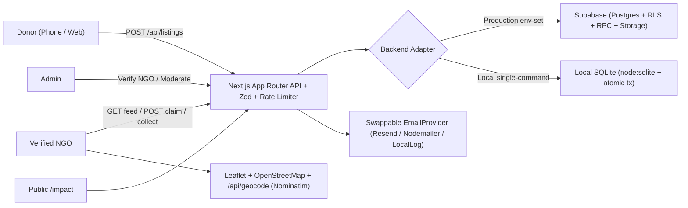

<<<<<<< HEAD
# FoodBridge — Surplus Food Waste Connector

> Redirecting safe surplus food from hostels, wedding halls, restaurants, and caterers to verified nearby NGOs in under 60 seconds.

---

## Problem Statement

Every day, edible surplus food from college hostels, wedding halls, corporate cafeterias, and restaurants is discarded while local NGOs, night shelters, and community kitchens actively search for safe meals. Coordination happens over ad-hoc phone calls and WhatsApp forwards—too slow for perishable food that expires within hours.

**FoodBridge** solves this with a fast, safety-first coordination platform:
- Donors post surplus food in **under 60 seconds**.
- **Admin-verified NGOs** nearby receive alerts and view live listings on a distance-sorted feed and interactive map.
- **Atomic claiming** locks each batch to a single NGO, and confirmed pickups power a **public Impact Dashboard**.

---

## Key Features

- **Role-Based Auth & Route Protection**: Email + password signup/login for Donors, NGOs (pending admin verification), and Admins.
- **Fast Surplus Listing Form (`< 60s`)**: Food name, category, Veg/Non-Veg flag, quantity (`kg` or `servings`), prepared time, `safe_until` deadline, pickup window, Nominatim-geocoded address + interactive pin, optional photo upload, and notes.
- **Food Safety & Trust Guardrails**:
  - Enforces a **maximum 6-hour** `safe_until` window from `prepared_at` on both client and server.
  - Mandatory 3-point donor safety checklist (stored hygienically, covered/sealed, never previously served).
  - Auto-expiry removes stale listings from the NGO feed and shows live countdown timers.
  - Admin verification required before NGOs can claim food.
  - Post-collection rating & issue reporting + dedicated `/disclaimer` page.
- **NGO Discovery Feed & Interactive Map**: Filter by radius (`2 / 5 / 10 / 25 km`), food category, Veg-only, and minimum quantity; sorted by urgency & Haversine distance; interactive **Leaflet + OpenStreetMap** view.
- **Concurrency-Safe Claim & Collection Flow**: Atomic database claim locking prevents double-claims; NGOs can cancel claims (returning listings to `Available`); either Donor or NGO can confirm collection with actual weight collected.
- **Swappable Email Notifications**: Clean `EmailProvider` interface supporting **Resend**, **Nodemailer (SMTP)**, and a **LocalLog** audit trail (`notifications_log`).
- **Public Impact Dashboard (`/impact`)**: Live kg redirected, estimated meals (`1 meal = 0.4 kg`, configurable), CO2 avoided estimate, active donors & verified NGOs, and weekly Recharts bar chart.
- **Admin Console (`/admin`)**: Approve/revoke NGOs and donors, moderate/remove listings, resolve safety reports, and inspect dispatched emails.

---

## Tech Stack

| Layer | Technology |
| :--- | :--- |
| Frontend | Next.js (App Router), React, TypeScript (strict), Tailwind CSS |
| Backend / DB / Auth / Storage | **Supabase** (PostgreSQL, RLS, Auth, Storage) for production; built-in **Node SQLite** (`node:sqlite`) adapter for zero-config single-command local runs |
| Maps & Geocoding | **Leaflet + OpenStreetMap** tiles, **Nominatim** geocoding API |
| Validation | **Zod** (shared client + server schemas) |
| Email | **Resend** / **Nodemailer** behind swappable `EmailProvider` |
| Charts | **Recharts** |
| Testing | **Vitest** (unit tests) + **Playwright** (E2E browser tests) |
| Deployment | **Vercel** (Next.js frontend & API) + **Supabase** (Postgres, Auth, Storage) |

---

## Architecture Diagram



---

## Database Schema

Full PostgreSQL DDL, indexes, Haversine functions, atomic RPCs (`claim_listing`, `cancel_claim`, `confirm_collection`, `expire_stale_listings`), Row Level Security policies, and Storage bucket setup are in [001_init.sql](file:///e:/first_project/supabase/migrations/001_init.sql).

- **`profiles`**: `id`, `email`, `role` (`donor` | `ngo` | `admin`), `org_name`, `contact_name`, `phone`, `address`, `lat`, `lng`, `verified`, timestamps.
- **`listings`**: `id`, `donor_id` (FK), `title`, `food_type`, `veg_flag`, `quantity`, `unit`, `quantity_kg`, `prepared_at`, `safe_until`, `pickup_address`, `lat`, `lng`, `pickup_window_start`, `pickup_window_end`, `photo_url`, `notes`, `safety_hygienic`, `safety_covered`, `safety_not_served`, `status` (`available` | `claimed` | `collected` | `expired` | `cancelled`), `claimed_by` (FK), `claimed_at`, `collected_at`, `collected_by`, `actual_quantity`.
- **`notifications_log`**: `id`, `recipient_id`, `recipient_email`, `listing_id`, `event_type`, `provider`, `status`, `subject`, `payload`, `created_at`.
- **`reports`**: `id`, `listing_id` (FK), `reporter_id` (FK), `rating`, `reason`, `details`, `resolved`, `created_at`.

---

## Screenshots (Pilot Placeholders)

- `docs/screenshots/landing.png` — Landing page with live impact snapshot and 3-step guide
- `docs/screenshots/donor-new.png` — Mobile-first `< 60s` listing form with safety checklist
- `docs/screenshots/ngo-map.png` — NGO radius feed + Leaflet OpenStreetMap view
- `docs/screenshots/impact-dashboard.png` — Public impact dashboard with Recharts weekly chart

---

## Local Setup (Single Command)

Requirements: **Node.js 22+** (Node 24 recommended, built-in `node:sqlite`).

```bash
# 1. Install dependencies
npm install

# 2. Start the app locally (auto-creates and seeds .data/foodbridge.db on first run)
npm run dev
```

Open **http://localhost:3000**.

To reset or re-seed the Bengaluru demo dataset (1 admin, 5 donors, 5 NGOs, 20 varied listings, 2 reports):

```bash
npm run seed
```

### Running Tests & Checks

```bash
npm run typecheck
npm run test
npm run test:e2e
```

---

## Environment Variables

Copy `.env.example` to `.env.local` for custom configuration:

| Variable | Purpose | Default |
| :--- | :--- | :--- |
| `FOODBRIDGE_BACKEND` | `auto`, `local`, or `supabase` | `auto` |
| `FOODBRIDGE_SESSION_SECRET` | Cookie signing key for local auth | dev secret |
| `NEXT_PUBLIC_SUPABASE_URL` | Supabase project URL | empty (local mode) |
| `NEXT_PUBLIC_SUPABASE_ANON_KEY` | Supabase anon key | empty |
| `SUPABASE_SERVICE_ROLE_KEY` | Supabase service role key (for seed & server notifications) | empty |
| `RESEND_API_KEY` | Resend API key for transactional emails | empty (`local_log` fallback) |
| `SMTP_HOST`, `SMTP_PORT`, `SMTP_USER`, `SMTP_PASS` | Nodemailer SMTP credentials (if not using Resend) | empty |
| `NEXT_PUBLIC_MEAL_WEIGHT_KG` | Kg per estimated meal | `0.4` |
| `NEXT_PUBLIC_CO2_PER_KG` | Estimated kg CO2e avoided per kg food | `2.5` |
| `NEXT_PUBLIC_MAX_SAFE_HOURS` | Max safe-until hours from `prepared_at` | `6` |

---

## Deploying to Vercel + Supabase

1. **Create a Supabase project**:
   - Open the SQL Editor in Supabase and execute `supabase/migrations/001_init.sql`.
   - Note your `Project URL`, `anon` key, and `service_role` key.
2. **Seed production demo data (optional)**:
   - Set `NEXT_PUBLIC_SUPABASE_URL` and `SUPABASE_SERVICE_ROLE_KEY` in `.env.local` and run `npm run seed`.
3. **Deploy Frontend to Vercel**:
   - Push this repository to GitHub and import into Vercel.
   - Add `NEXT_PUBLIC_SUPABASE_URL`, `NEXT_PUBLIC_SUPABASE_ANON_KEY`, `SUPABASE_SERVICE_ROLE_KEY`, `RESEND_API_KEY`, and `EMAIL_FROM` in Vercel Environment Variables.
   - Deploy! Next.js automatically switches to the Supabase + Resend adapters when those variables are present.

---

## Future Improvements

- WhatsApp one-tap share link & WhatsApp Business alert bot for NGO pickup drivers.
- Hindi + English (and Kannada/regional) UI language toggle.
- Recurring donor templates (e.g., daily hostel mess schedules).
- Offline-capable PWA installability for low-connectivity event kitchens.
- Dedicated volunteer driver pickup coordination role.
=======
# Food-Bridge
FoodBridge – A smart food donation and redistribution platform connecting food donors with people in need. Built using Next.js, TypeScript, and Supabase to reduce food waste and fight hunger.
>>>>>>> 55bb6071cfc19a07b17f527f51c035e7ea1238ea
